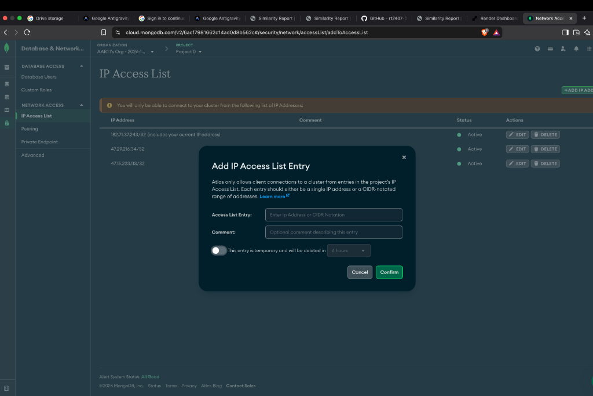
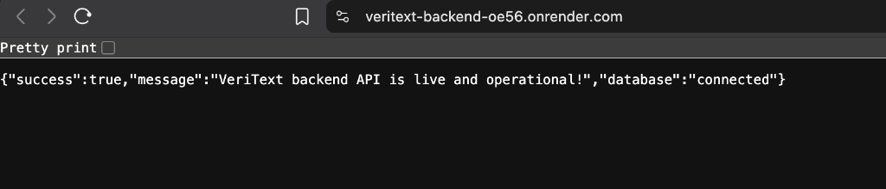
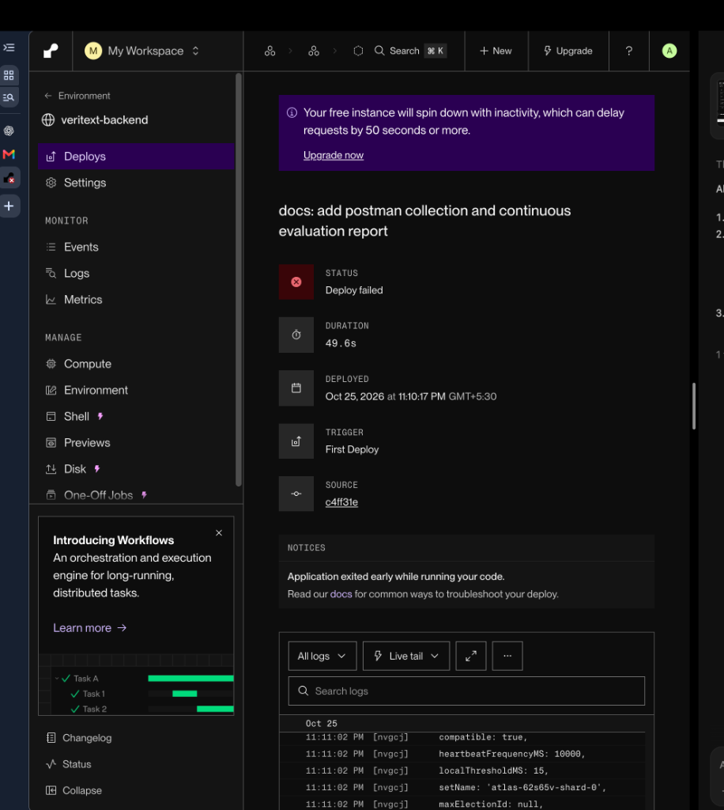
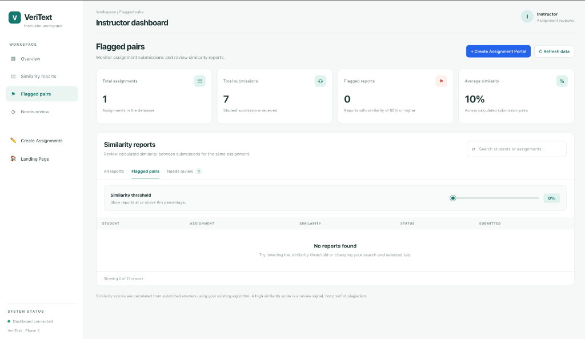

# VeriText — Full-Stack Academic Integrity & Plagiarism Detection Platform

[](https://nodejs.org/)
[](https://expressjs.com/)
[](https://www.mongodb.com/atlas)
[](https://veritext-backend-oe56.onrender.com)
[](https://jwt.io/)
[](https://vitejs.dev/)

VeriText is a full-stack academic integrity and source code / text similarity review platform built with **Node.js, Express, MongoDB Atlas, and React**. It enables educators to create multi-question text and code assignments, accepts student submissions via direct input or file uploads (`.java`, `.py`, `.cpp`, `.txt`), and computes cross-submission plagiarism percentages using a server-side **N-gram tokenizer and Jaccard similarity coefficient engine**.

---

## 🌐 Live Cloud Deployment

* **Live Cloud Service URL:** [https://veritext-backend-oe56.onrender.com](https://veritext-backend-oe56.onrender.com)
* **API Endpoints Directory:** [https://veritext-backend-oe56.onrender.com/api](https://veritext-backend-oe56.onrender.com/api)
* **Cloud Database:** MongoDB Atlas (Persistent Cloud Cluster)
* **API Health Check:**
  ```json
  {
    "success": true,
    "message": "VeriText backend API is live and operational!",
    "endpoints": {
      "health": "/api/health",
      "assignments": "/api/assignments",
      "submissions": "/api/submissions",
      "similarityReports": "/api/similarity-reports",
      "students": "/api/students",
      "instructors": "/api/instructors"
    },
    "database": "connected"
  }
  ```

---

## 📸 Screenshots & Verification

### 1. Render Cloud Deployment (Status: Live)


### 2. Live API Health & MongoDB Atlas Connectivity


### 3. Automated Cloud Build & Deploy Pipeline


### 4. Continuous Evaluation Criteria Rubric


---

## 🏗️ Monorepo Project Structure

```text
The_Assignment_Plagiarism/
│
├── backend/                                # Node.js / Express MVC Server
│   ├── config/                             # Database & server configuration
│   ├── controllers/                        # Business logic & request handlers
│   │   ├── assignmentController.js         # Assignment CRUD & code generation
│   │   ├── instructorController.js         # Instructor signup & JWT login
│   │   ├── studentController.js            # Student signup & roll-number login
│   │   ├── submissionController.js         # Text & Multer file submissions
│   │   └── similarityReportController.js   # Pairwise n-gram report calculation
│   ├── middleware/                         # Express middleware stack
│   │   ├── authMiddleware.js               # JWT role validation (instructor/student)
│   │   └── uploadMiddleware.js             # Multer in-memory storage for file uploads
│   ├── models/                             # Mongoose database schemas
│   │   ├── Assignment.js                   # Questions, constraints, thresholds
│   │   ├── Instructor.js                   # Instructor profiles with bcrypt passwords
│   │   ├── Student.js                      # Student profiles (roll number / email)
│   │   ├── Submission.js                   # Student answers, file buffers, timestamps
│   │   └── SimilarityReport.js             # Pairwise similarity matrix & flags
│   ├── routes/                             # Modular REST API endpoints
│   ├── utils/                              # Mathematical & algorithmic engines
│   │   └── ngramSimilarity.js              # Server-side N-gram & Jaccard algorithm
│   ├── .env.example                        # Template for environment variables
│   ├── package.json                        # Backend dependencies & scripts
│   └── server.js                           # Express application entry point (0.0.0.0)
│
├── frontend/                               # React & Modern Web Frontend
│   ├── css/                                # Global styles & responsive layouts
│   ├── dist/                               # Production Vite bundle
│   ├── js/                                 # API communication & UI rendering
│   │   ├── instructor.js                   # Instructor dashboard & assignment forms
│   │   ├── report.js                       # Similarity report UI, slider & comparison toggle
│   │   ├── student.js                      # Student assignment viewer & submission form
│   │   └── student-auth.js                 # Student login & session handling
│   ├── public/                             # Static SVGs, icons, and assets
│   ├── src/                                # React application source (Vite)
│   │   ├── services/api.js                 # Cloud API integration layer
│   │   ├── App.jsx                         # React dashboard root component
│   │   └── main.jsx                        # React DOM mounting
│   ├── index.html                          # Landing page
│   ├── instructor.html                     # Instructor management dashboard
│   ├── report.html                         # Detailed plagiarism report & comparison page
│   ├── student.html                        # Student submission portal
│   ├── login.html / signup.html            # Instructor authentication pages
│   ├── student-login.html / signup.html    # Student authentication pages
│   ├── package.json                        # Frontend dependencies (React, Vite)
│   └── vite.config.js                      # Multi-page build configuration
│
├── docs/                                   # Documentation & screenshots
│   └── screenshots/                        # Live cloud deployment proofs
│
├── .gitignore                              # Protects secrets (.env) & build artifacts
├── package.json                            # Root workspace scripts (runner)
└── README.md                               # Project documentation
```

---

## 🧠 Server-Side N-Gram Similarity Engine

VeriText avoids brittle string matching by employing server-side **N-gram tokenization and Jaccard similarity scoring** in `backend/utils/ngramSimilarity.js`:

```text
                        ┌────────────────────────────────┐
                        │      Submitted Answers /       │
                        │    Uploaded Solution Files     │
                        └───────────────┬────────────────┘
                                        │
                                        ▼
                        ┌────────────────────────────────┐
                        │   Text & Code Normalization    │
                        │ (strip comments, symbols, etc.)│
                        └───────────────┬────────────────┘
                                        │
                                        ▼
                        ┌────────────────────────────────┐
                        │     N-Gram Tokenization        │
                        │ (window size: 3-5 word/char)   │
                        └───────────────┬────────────────┘
                                        │
                                        ▼
                        ┌────────────────────────────────┐
                        │  Jaccard Coefficient Scoring   │
                        │   |Set A ∩ Set B| / |A ∪ B|    │
                        └───────────────┬────────────────┘
                                        │
                                        ▼
                        ┌────────────────────────────────┐
                        │  Cross-Submission Pair Matrix  │
                        │ (Flagged if Similarity >= Thr) │
                        └────────────────────────────────┘
```

1. **Normalization:** Strips variable casing, indentation differences, punctuation, and language comments (`//`, `/* */`, `#`).
2. **Tokenization:** Breaks the stream into sequential n-grams (sub-sequences of $N$ tokens).
3. **Set Intersection:** Measures the overlap of shared n-gram signatures between all submission pairs for a given assignment.
4. **Dynamic Threshold Filtering:** Reports allow instructors to dynamically adjust the similarity threshold slider (0% to 100%) in real time to filter out low-probability matches and highlight high-risk pairs.

---

## 👥 Team Work Division (Continuous Evaluation 2)

| Contributor | GitHub Username | Work Share | Assigned Responsibilities & Deliverables |
| :--- | :--- | :---: | :--- |
| **Aarti Thakur** | `rt2407-08` | **40% (Lead)** | **Cloud Deployment & Full-Stack Integration:**<br>• Deployed Node.js Express backend to Render (`0.0.0.0` binding)<br>• MongoDB Atlas network whitelist & production environment management<br>• Replaced all local URLs with deployed cloud API across frontend<br>• Implemented real-time **Similarity Threshold Slider** & debounced comparison toggle<br>• Postman collection & team Git merge integration |
| **Ishita Dahiya** | `ishitadahiya53-sys` | **30%** | **MVC Architecture & Database Models:**<br>• Designed Mongoose schemas (`Assignment`, `Submission`, `Student`, `Instructor`, `SimilarityReport`)<br>• Implemented student & instructor signup/login controllers<br>• Implemented JWT token generation with role scopes (`instructor`, `student`)<br>• Modular Express routing and request validation |
| **Krrish Makkar** | `Krrish-1845` | **30%** | **Core Algorithm & File Pipeline:**<br>• Engineered server-side N-Gram tokenization and Jaccard similarity engine<br>• Configured Multer in-memory storage middleware for file uploads (`.java`, `.py`, `.cpp`, `.txt`)<br>• Built cross-submission pairwise comparison runner<br>• Created persistent similarity report controllers and submission extraction endpoints |

---

## 🌿 Git Branching & Feature Workflow

The project strictly follows a feature-branch team workflow:

* **`feature/mvc-architecture`** (Ishita Dahiya): Frontend restructuring, database models, and authentication controllers.
* **`feature/similarity-algorithm`** (Krrish Makkar): N-gram tokenizer, Multer middleware, and pairwise comparison matrix.
* **`feature/cloud-deployment-frontend`** (Aarti Thakur): Express production server, Render cloud deployment, live API wiring, and interactive threshold slider.
* **`main`**: Production-ready branch containing merged feature branches with explicit merge commits.

---

## 📡 REST API Reference

| Endpoint | Method | Auth | Description |
| :--- | :---: | :---: | :--- |
| `/` or `/api` | `GET` | Public | Live cloud health check and endpoints directory |
| `/api/instructors/signup` | `POST` | Public | Register new instructor account |
| `/api/instructors/login` | `POST` | Public | Authenticate instructor and return JWT token |
| `/api/students/signup` | `POST` | Public | Register student (requires unique student ID and email) |
| `/api/students/login` | `POST` | Public | Authenticate student via roll number or email |
| `/api/assignments` | `GET` | Public | List all assignments with question counts |
| `/api/assignments` | `POST` | Instructor | Create new assignment with questions and threshold |
| `/api/assignments/code/:code` | `GET` | Public | Fetch assignment details by unique code (e.g. `VT-6D8RZ6`) |
| `/api/submissions` | `POST` | Student | Submit assignment answers (supports JSON or multipart file upload) |
| `/api/assignments/:id/similarity-report` | `GET` | Instructor | Compute and retrieve live server-side N-gram similarity report |

---

## 💻 How to Run Locally

### 1. Prerequisites
- **Node.js** v18 or higher
- **npm** v9 or higher
- **MongoDB Atlas** connection string (or local MongoDB on port 27017)

### 2. Clone the Repository
```bash
git clone https://github.com/rt2407-08/The_Assignment_Plagiarism.git
cd The_Assignment_Plagiarism
```

### 3. Backend Setup
```bash
cd backend
npm install
cp .env.example .env
```
Fill in your `.env` configuration:
```env
PORT=5000
MONGODB_URI=your_mongodb_atlas_connection_string
JWT_SECRET=your_jwt_secret_key
```
Start the backend server:
```bash
npm start
# Server runs on http://localhost:5000
```

### 4. Frontend Setup
```bash
cd ../frontend
npm install
npm run dev
# Vite dev server runs on http://localhost:5173
```

### 5. Running from Root
From the repository root, you can also run:
```bash
npm run server    # Starts backend server
npm run client    # Starts frontend Vite dev server
```

---

## 📄 License & Academic Integrity
This project is developed for educational and academic evaluation purposes. Built with ❤️ by Aarti Thakur, Ishita Dahiya, and Krrish Makkar.
